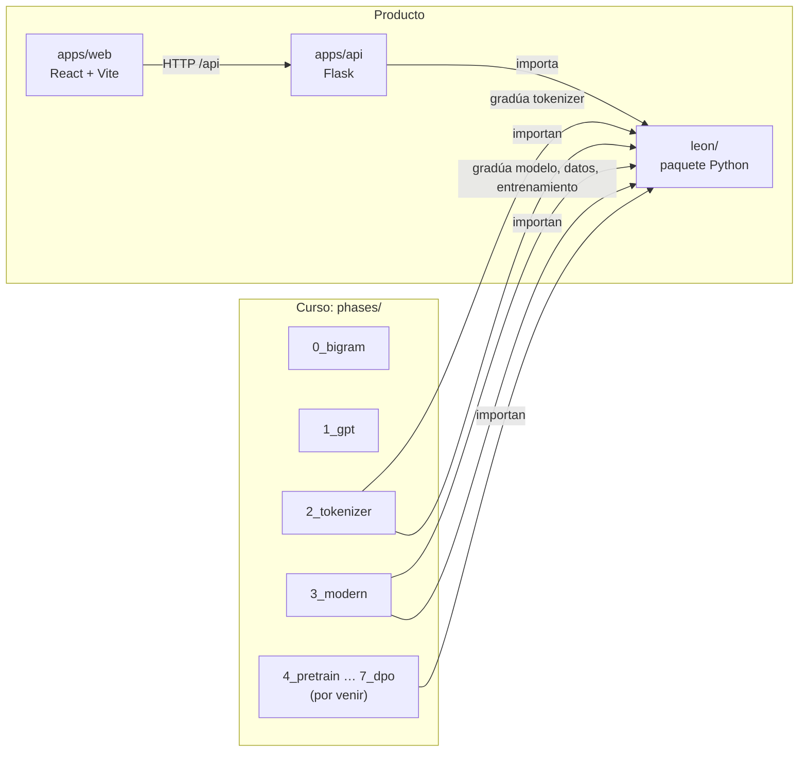
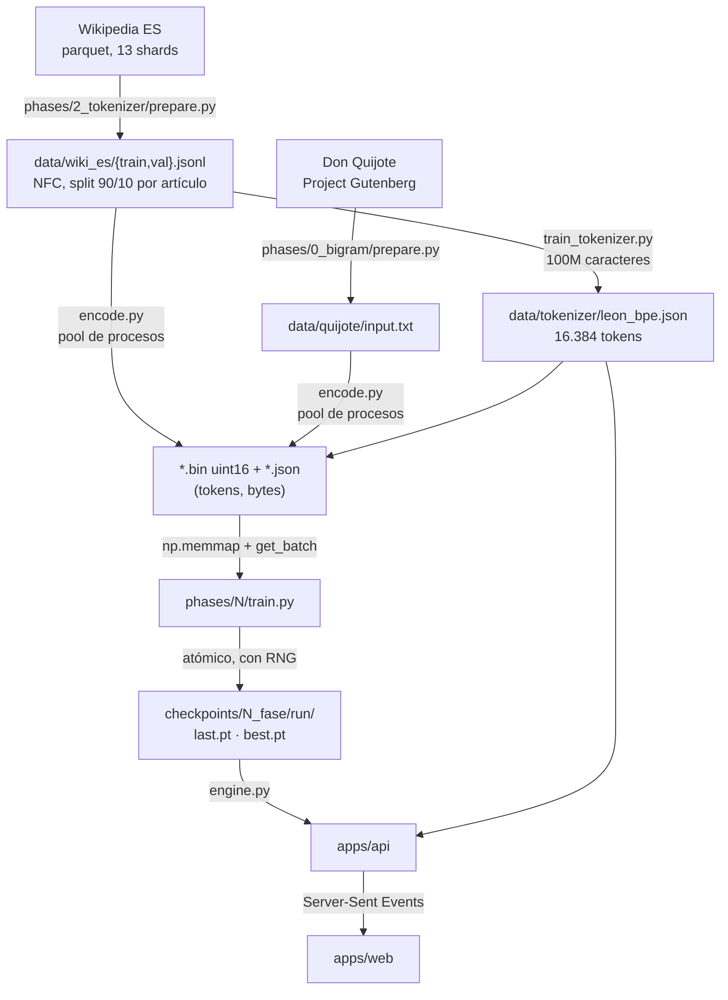
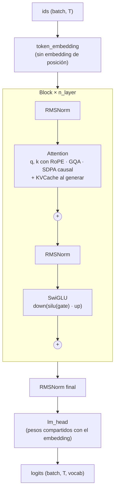

# Arquitectura

Mapa técnico del repositorio: qué piezas hay, cómo fluyen los datos entre ellas, qué formatos comparten y qué reglas no deben romperse. Para la motivación y los conceptos de fondo, ver [`docs/fundamentos.md`](docs/fundamentos.md). Para el detalle y los resultados de cada etapa, ver el `README.md` de cada fase.

## Visión general

El repositorio tiene dos mitades con propósitos distintos:

- **El curso** (`phases/`): una carpeta por fase, que se lee en orden. Cada fase contiene sus scripts, un README con resultados medidos y un notebook que reconstruye las piezas paso a paso.
- **El producto** (`leon/` y `apps/`): el código definitivo de Leon 0.1, que se reutiliza, está testeado y es estable.

Cuando una fase produce un componente que usarán fases posteriores o las apps, ese componente se **gradúa** a `leon/`. La fase conserva los scripts que lo entrenan, lo miden y lo explican. Las fases 0 y 1 son prototipos autocontenidos: no dependen de `leon/` y nada depende de ellas.



## Flujo de datos



`data/` y `checkpoints/` no se versionan: todo se reconstruye con los scripts de las fases.

## El paquete `leon/`

| Módulo | Responsabilidad | Depende de |
|---|---|---|
| `paths.py` | Rutas de `data/`, `checkpoints/` y del tokenizer | — |
| `tokenizer.py` | `BPETokenizer`: pre-tokenización por regex, entrenamiento BPE incremental, `encode`/`decode`, tokens especiales, `save`/`load` | — |
| `model.py` | `Leon` y `LeonConfig`: RMSNorm, RoPE, atención con GQA, SwiGLU, `KVCache`, `stream`/`generate` | torch |
| `data.py` | `TokenFile` (`.bin` con `np.memmap`, `get_batch`), `load_splits`, `load_tokenizer` | `paths`, `tokenizer` |
| `training.py` | `lr_at`, `estimate_loss`, `bits_per_byte`, `save_checkpoint`/`load_checkpoint` | `model`, `data` |
| `run.py` | `RunFiles`: ficheros de control de un entrenamiento en segundo plano (`PAUSE`, `status.json`, `train.pid`, `train.log`), `is_process_alive`, `keep_system_awake` | — |
| `chat.py` | `encode_chat`: el chat template | `tokenizer` |

### El modelo



Configuración de Leon 0.1 (fijada en la fase 3 midiendo el throughput): `n_embd=640`, `n_layer=10`, `n_head=10`, `n_kv_head=5`, `block_size=1024`, `vocab_size=16384`. Son 56M de parámetros, 45,5M sin el embedding.

## Formatos compartidos (contratos)

Estos formatos los producen unas piezas y los consumen otras. Cambiarlos rompe datos o checkpoints existentes.

### Vocabulario

| ids | Contenido |
|---|---|
| 0–255 | Los 256 bytes. Cualquier texto es codificable y no existe el token desconocido |
| 256–16.367 | Los 16.112 merges, en el orden en que se aprendieron (el id es también la prioridad al codificar) |
| 16.368–16.383 | 16 tokens especiales: `<\|endoftext\|>` 16368, `<\|system\|>` 16369, `<\|user\|>` 16370, `<\|assistant\|>` 16371, `<\|end\|>` 16372, `<\|tool_call\|>` 16373, `<\|/tool_call\|>` 16374, `<\|tool_result\|>` 16375, `<\|/tool_result\|>` 16376, `<\|reserved_0..6\|>` |

Los especiales se reservaron en la fase 2 para que el vocabulario no cambie entre el preentrenamiento (fase 4), el SFT (fase 5) y el tool calling (fase 6).

### Ficheros de tokens (`*.bin` + `*.json`)

- **`.bin`**: ids en uint16 contiguos, sin cabecera. Por eso el vocabulario no puede pasar de 65.536 tokens.
- **`.json`**: `{"tokens", "bytes", "documents", "bytes_per_token", "tokenizer"}`. `bytes` cuenta solo el texto original; `<|endoftext|>` cuenta como 0 bytes.
- **En Wikipedia**, cada artículo va seguido de `<|endoftext|>`.
- **Split**: 1 de cada 10 artículos va a val. En el Quijote es el mismo corte 90/10 por caracteres que en las fases 0 y 1.

### Checkpoints (`checkpoints/<N_fase>/<run>/{last,best}.pt`)

| Clave | Contenido |
|---|---|
| `model` | `state_dict` |
| `config` | `asdict(LeonConfig)`. La arquitectura sale siempre de aquí, nunca de la línea de comandos |
| `step`, `best_val` | Progreso |
| `optimizer` | Solo en `last.pt`. `best.pt` no lo necesita y ocupa un tercio |
| `rng_cpu`, `rng_cuda` | Estado de los generadores aleatorios, para que `--resume` continúe con los mismos batches |
| `settings` | Los argumentos de la ejecución (lr, dataset, pasos...) |
| `stage` | *(fase 5+)* `"chat"` en los modelos con SFT. Si falta, la API lo trata como `"base"` |

Se escriben de forma atómica: primero un `.tmp` y luego `os.replace`.

### Chat template

```
<|system|>…<|end|><|user|>…<|end|><|assistant|>…<|end|><|user|>…<|end|><|assistant|>
```

Lo define `leon.chat.encode_chat`, y es la única implementación: la fase 5 lo usará para entrenar y `apps/api` para la inferencia.

### API HTTP

`GET /api/models` y `POST /api/generate` (Server-Sent Events). Ver [`apps/README.md`](apps/README.md).

## Decisiones de diseño

| Decisión | Por qué |
|---|---|
| BPE a nivel de byte, propio, 16k tokens | Cubre cualquier texto sin token desconocido. Con 16k, el embedding cuesta 10,5M parámetros; 32k o 50k serían demasiados para un modelo de 56M |
| Datos en disco como uint16 + `np.memmap` | Miles de millones de tokens con 16 GB de RAM: solo se leen las ventanas de cada batch |
| Micro-batches de 4.096 tokens + gradient accumulation | Con 16k de vocabulario, los logits de 16k tokens ocupan ~3,5 GiB en fp32. Al pasar de 8 GiB, Windows desborda a RAM sin avisar y la velocidad cae de 10 a 30 veces |
| `torch.compile` | ×1,5–1,6 de throughput, porque fusiona RMSNorm, RoPE, SwiGLU y la loss |
| GQA con `repeat_interleave` y no `enable_gqa` | `enable_gqa` resultó un 20 % más lento en esta GPU: abandona el kernel de flash attention |
| Checkpoints atómicos con RNG | Los entrenamientos de horas se reparten en sesiones: un corte no debe perder el progreso y el resume debe ser idéntico a no haber parado (`tests/test_training.py`) |
| Tokens especiales solo por id | `encode` ignora los especiales por defecto y el chat template los inserta por id. Así el texto de un usuario o de una web no puede inyectar turnos ni llamadas a herramientas |
| API de un modelo y una petición a la vez | Herramienta local de un solo usuario: un `threading.Lock` basta y mantiene la VRAM bajo control |
| API solo local | Escucha en `127.0.0.1` y valida la cabecera `Host`, contra el *DNS rebinding* |
| Web separada (React) de la API (Flask) | Se desarrollan por separado (`npm run dev` con proxy). En uso normal, Flask sirve la web compilada desde el mismo puerto |

## Reglas de dependencias

1. **`leon/` no importa nada** de `phases/`, `apps/` ni `tests/`: solo la biblioteca estándar, numpy, torch y sus propios módulos.
2. **Las fases 2 en adelante** importan de `leon/` y nunca entre ellas. Si dos fases necesitan lo mismo, ese código se gradúa a `leon/`.
3. **Las fases 0 y 1** no importan de `leon/`: son prototipos autocontenidos y se pueden leer sin conocer el resto.
4. **`apps/api`** importa de `leon/`. **`apps/web`** solo habla con la API por HTTP.
5. **Ningún script modifica `sys.path`** para encontrar `leon`, que se instala con `pip install -e .`. Las únicas excepciones son los notebooks y `tests/test_api.py`, que cargan código que no es un paquete (`phases/1_gpt`, `apps/api`).

`tests/test_architecture.py` comprueba automáticamente las reglas 1 y 3.

## Puntos de extensión (fases 4–6)

| Fase | Dónde | Qué reutiliza |
|---|---|---|
| 4: preentrenamiento | **Implementada**: `phases/4_pretrain/control.py` (prepare, start, pause, resume, status) lanza `train.py` como proceso independiente. Pausar y continuar da exactamente los mismos pesos que entrenar sin parar | `leon.data`, `leon.model`, `leon.training`, `leon.run` |
| 5: SFT conversacional | `phases/5_sft/`: dataset de diálogos codificado con `encode_chat` y targets a `-100` en los turnos no del asistente (`ignore_index` de la loss). Checkpoints con `stage="chat"` | `leon.chat`, `leon.training`; la loss de `Leon.forward` ya ignora los targets `-100` |
| 6: tool calling | `apps/api/engine.py`: detectar `<\|tool_call\|>…<\|/tool_call\|>`, ejecutar la herramienta, insertar `<\|tool_result\|>…<\|/tool_result\|>` y continuar generando. Las herramientas irán en un módulo propio de `leon/` o de `apps/api` | tokens especiales ya reservados |
